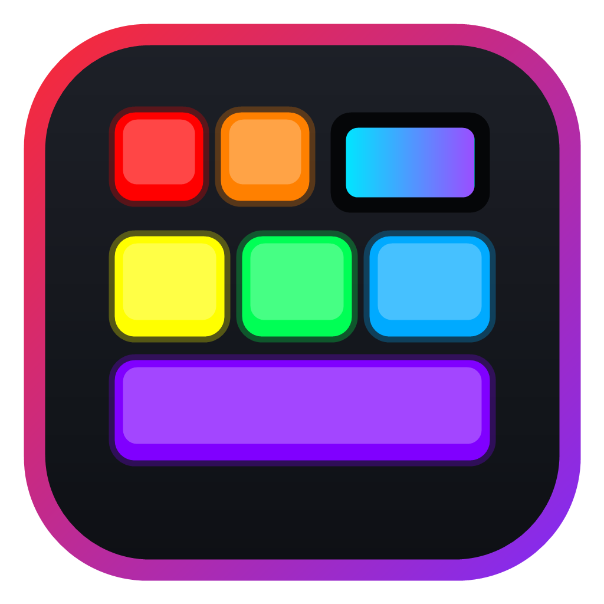
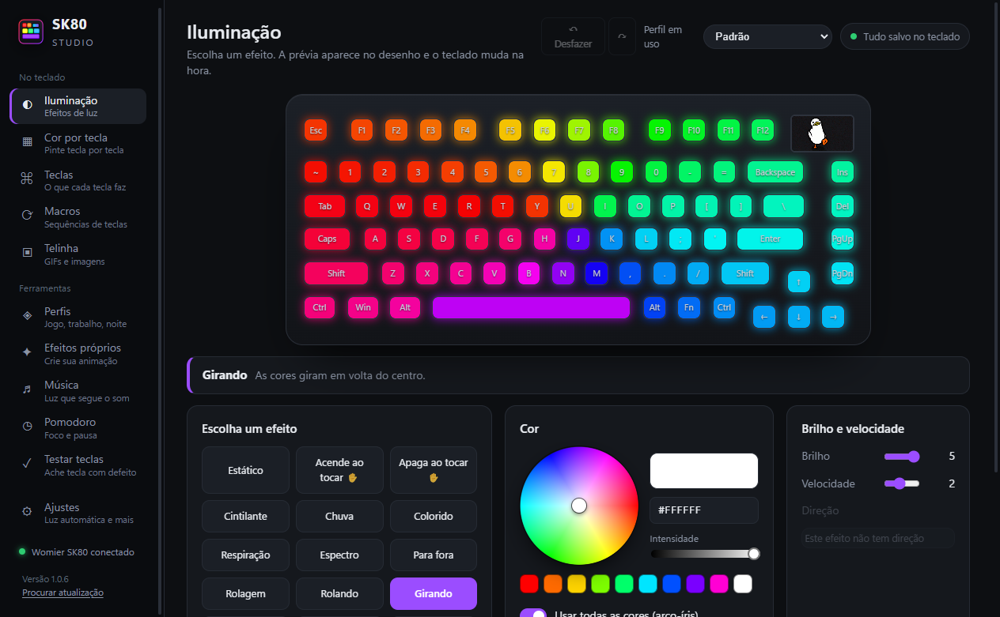

<p align="center"></p>

<h1 align="center">SK80 Studio</h1>

<p align="center">
  Um aplicativo bonito e simples para controlar o teclado <b>Womier / XVX SK80</b> (o que tem a telinha).<br>
  Feito para substituir o driver oficial.
</p>

<p align="center">
  <a href="https://github.com/Kinglucas962/sk80-studio/releases/latest"><b>⬇ Baixar para Windows</b></a>
</p>



## O que ele faz

- **Iluminação**: os 19 efeitos do teclado, roda de cores, brilho, velocidade e direção, com uma prévia animada de cada efeito no teclado desenhado.
- **Cor por tecla**: clique ou arraste para pintar. Também tem modelos prontos (WASD, jogo FPS, setas, F1–F12…) e degradê entre duas cores ou arco-íris.
- **Teclas**: troque o que cada tecla faz, na camada normal e na camada Fn. Pode virar outra tecla, atalho, comando de mídia, macro ou ficar desativada.
- **Macros**: grave sequências de teclas, edite cada passo e escolha como elas tocam: uma vez, repetir N vezes, ou liga/desliga. Tem uma biblioteca de macros prontas e dá para exportar e importar.
- **Telinha**: mande GIFs e imagens para a tela de 160×96. Dá para enquadrar com zoom e escolher os quadros. Tudo que você envia fica numa biblioteca.
- **Perfis**: cada perfil guarda luz, cores, teclas e macros. Troque com um clique, ou deixe o app trocar sozinho quando você abrir um programa ou jogo.
- **Pomodoro**: as teclas F1–F12 viram um cronômetro que vai apagando.
- **Luz automática**: apaga quando o PC bloqueia ou fica parado, e muda por horário (diminui, apaga ou troca de perfil à noite).
- **Atalho global** para trocar de perfil (padrão Ctrl + Alt + P).
- **Indicadores**: o Caps Lock fica aceso numa cor, e uma tecla pisca quando chega mensagem (WhatsApp, Telegram…).
- **Testador de teclas**: mostra quais teclas funcionam e avisa se alguma dá clique duplo.
- **Galeria da comunidade**: baixe perfis prontos ou [mande o seu](https://github.com/Kinglucas962/sk80-studio/issues/new?template=perfil.md).
- **Bandeja do Windows**, início junto com o Windows e **atualização automática**.

Tudo é salvo sozinho: não existe botão "Salvar".

## Instalação

1. Baixe o `SK80-Studio-Setup-x.y.z.exe` na página de [Releases](https://github.com/Kinglucas962/sk80-studio/releases/latest).
2. Rode o instalador. O Windows pode mostrar "O Windows protegeu o computador", porque o instalador não tem assinatura digital paga. Clique em **Mais informações → Executar assim mesmo**.
3. Feche o driver oficial antes de usar, para os dois não brigarem pelo teclado.

O app se atualiza sozinho: quando sai uma versão nova, ele baixa em segundo plano e instala quando você fecha o app.

## Cuidados

- O envio para a telinha é lento de propósito (cerca de 1 s por quadro). Se mandar rápido demais, o teclado trava. Se travar, desconecte e conecte o cabo.
- GIFs com mais de 33 quadros só podem ser enviados com o **modo teste** ligado, em Ajustes, porque ainda não foram testados.
- O modo de macro que repete para sempre (sem como parar) não é usado de propósito.

## Para desenvolvedores

```bash
npm install
npm start          # roda pelo código-fonte
npm run dist       # gera o instalador em dist/
npm run icons      # redesenha os ícones (build/make-icons.ps1)
```

Para lançar uma versão nova:

1. Aumente `version` no `package.json`.
2. Rode `npm run dist`.
3. Crie uma release `vX.Y.Z` no GitHub com os arquivos `dist/SK80-Studio-Setup-X.Y.Z.exe`, `dist/SK80-Studio-Setup-X.Y.Z.exe.blockmap` e `dist/latest.yml`.

O `latest.yml` é o arquivo que os apps instalados leem para saber que existe atualização.

O protocolo USB foi descoberto observando o tráfego HID do driver oficial. Ele está documentado nos comentários de [`src/sk80.js`](src/sk80.js).

## Aviso

Projeto pessoal e **não oficial**, sem ligação com a Womier ou a XVX. Use por sua conta e risco.

## Licença

[MIT](LICENSE) © 2026 Kinglucas962
